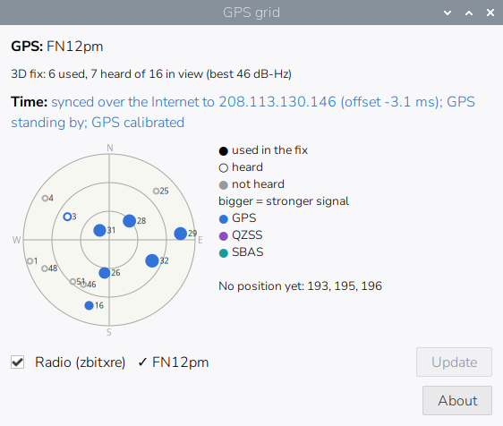
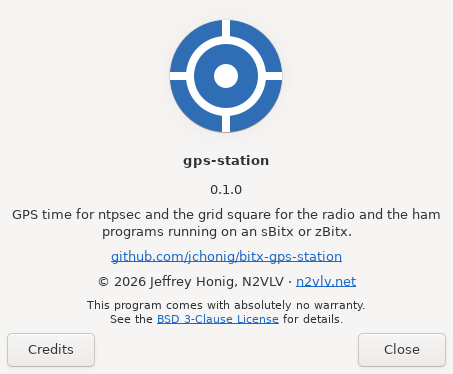

# bitx-gps-station

A GPS companion for the sBitx and zBitx, running either the original sbitx
software or the refactored zbitxre. It:

1. Keeps the radio's clock right from the GPS when network time isn't
   available.
2. Keeps the grid square up to date in the radio and in the ham programs
   running on it, such as WSJT-X and JS8Call.

It has two parts, in one package:

- `gps-station`: a system service for the clock and the radio's grid
- `gps-station-desktop`: a tray icon that watches WSJT-X, JS8Call and
  the other programs running on the desktop; it starts when you log in
  to the desktop, so a radio without one simply doesn't run it

To install and configure it, see [docs/INSTALL.md](docs/INSTALL.md).

## What it does

`gps-station` runs as a systemd service beside `gpsd` and does two jobs.

**Time.** As soon as gpsd starts writing time to shared memory (the
receiver has a fix), it writes a `refclock shm` line to its own file,
`/etc/ntpsec/conf.d/gps-station.conf`, and restarts ntpsec. Later, when ntpd is
synced to a network server and has heard the GPS steadily, it measures
how late the GPS's NMEA time arrives over ten polls, sets that as
`time1`, restarts ntpsec once more, and leaves it alone from then on.
With the network up, internet servers outvote the GPS; in the field, the
GPS keeps the clock.

`ntp.conf` itself is changed once: a line at its end,
`includefile /etc/ntpsec/conf.d/`, makes ntpsec read every `*.conf` file
in that directory, so other local settings can go there too. The file
also sets `tos minsane 1`. Debian's `ntp.conf` asks for three agreeing
sources before setting the clock, which a lone GPS in the field can never
be; with the network up there are plenty of servers either way. If
`ntp.conf` or another file in `conf.d` already has a `refclock shm` line,
it leaves ntpsec alone. Removing the package deletes its file, and the
include line too when no other `*.conf` is left in `conf.d`.
Development builds kept the refclock in a marked block inside `ntp.conf`;
that block is moved into the file.

### Calibrating the GPS time

The GPS reports the time in NMEA sentences sent over the serial (USB)
line a little after the second they describe; the delay depends on the
receiver, its baud rate and how many sentences it sends. ntpsec's
`time1` on the refclock line subtracts a fixed delay, and the service
measures it against network time once:

1. After adding the refclock it waits 15 minutes for ntpd to settle.
2. Then, every 64 seconds (one ntpd poll), it reads `ntpq -pn`. A sample
   counts only while a network server is the source the clock follows
   (`*`) and the GPS has answered its last eight polls (`reach 377`); if
   either lapses, the samples collected so far are dropped.
3. After 10 samples it takes their median offset. If that is 2 ms or
   more, it sets `time1` to the current value minus the offset (a GPS
   reading late shows a negative offset, so `time1` grows).
4. It marks the file `calibrated=yes`, restarts ntpsec, and doesn't
   measure again.

On the sBitx this was written on (a u-blox 7 at 9600 baud) the GPS
read 63.5 ms late; `time1` became `0.0635`, after which it agreed with
the network servers to within a few milliseconds. With no network the
GPS is used uncalibrated, about that much late, until the radio has had
the Internet for about 20 minutes. To measure again, see
[Recalibrating the GPS time](docs/INSTALL.md#recalibrating-the-gps-time).

**Grid.** It works out the 6-character (or, with `--chars 4`,
4-character) Maidenhead locator from the fix and sets it on the radio over
TCP port 8081, retrying until the radio program answers and the new value
reads back:

| Radio software      | Command sent    | Read back         |
| ------------------- | --------------- | ----------------- |
| zbitxre             | `MYGRID FN31pr` | greeting `MYGRID` |
| sbitx (JJ's, W9JES) | `grid FN31pr`   | `?MYGRID`         |

A new grid is sent only after it has held for a minute, so a fix
wandering along a grid line doesn't flip it back and forth, and a grid you
type on the radio yourself is left alone until you move.

## GPS receivers

gps-station reads the GPS through gpsd, so any receiver gpsd supports
works. What varies is whether gpsd picks it up by itself when it's
plugged in. Raspberry Pi OS (Trixie, gpsd 3.25) starts gpsd automatically
for these USB receivers, matched by USB ID in gpsd's
`/usr/lib/udev/rules.d/60-gpsd.rules`:

| Receiver                                     | USB ID                |
| -------------------------------------------- | --------------------- |
| u-blox 5, 6, 7, 8 and 9 with their own USB   | `1546:01a5` to `01a9` |
| Garmin USB, such as the GPS 18 USB           | `091e:0003`           |
| MediaTek-based, such as the Holux M-1200E    | `0e8d:3329`           |
| DeLorme (Cypress M8 chip), such as the LT-40 | `1163:0100`, `0200`   |
| PS-360 (sold with MS Streets and Trips 2005) | `067b:aaa0`           |
| ATEN UC-232A serial adapter                  | `0557:2008`           |
| Telit wireless modules                       | by USB interface      |

The common cheap USB "u-blox 7" dongles are in the first row; the zBitx
this was written on uses one.

Not detected automatically:

- Receivers built on a general USB-serial chip: Prolific PL2303, FTDI
  FT232 or Silicon Labs CP210x. Debian turns those rules off because the
  same chips are in many devices that aren't GPS receivers.
- A GPS module on the Pi's serial pins.

For those, gpsd has to be told where the receiver is; see
[Configuring gpsd](docs/INSTALL.md#configuring-gpsd), which also covers
the `-n` option the time job needs.

gps-station uses the time in the receiver's NMEA messages, not a PPS
signal; after calibration it agrees with network time to within a few
milliseconds, plenty for FT8 and the other digital modes.

## The desktop programs

The tray icon starts when you log in to the radio's desktop and puts a
GPS icon in the panel's tray. The crosshair shows the fix (grey none,
blue 2D, green 3D); a dot at its bottom right shows where the time comes
from (green the GPS, blue the Internet, red not synchronized); an amber
"!" at the top right means a ticked program's grid differs from the GPS.
Its tooltip says the same in words.


Clicking it opens a window, kept off the taskbar and above the radio's
full-screen window, showing:

- the GPS grid, and the receiver's state: no fix, 2D or 3D fix;
  satellites used, heard with any signal, and in view; the strongest
  signal
- a Time line saying what the clock follows (locked to the GPS, synced
  over the Internet with the GPS standing by, or not synchronized) and
  whether the GPS has been calibrated
- a map of the sky: each satellite at its direction and height (horizon
  outside, overhead in the middle, north up), coloured by system, filled
  when used in the fix, a ring when only heard, grey when not heard,
  bigger for a stronger signal; satellites whose position the receiver
  doesn't know yet are listed beside it
- a row for each supported program that is running



With more programs running, the rows look like this:

```text
[x] Radio (zbitxre)  ✓ FN31pr                  [Update]
[x] WSJT-X           ✗ AA11AA stale            [Update]
[x] JS8Call          ✋ FN42aa set by hand     [Update]
[ ] fldigi           ? can't read              [Update]
```

The window's **About** button (also on the tray icon's right-click
menu) shows the release number and links to this repository and the
author's page; `gps-station --version` and `gps-station-desktop
--version` print the release number.



Only programs that are running are looked at; a closed program is left
alone, because the radio may have moved by the time it is opened again.
Every 10 seconds each row is marked:

| Mark | Meaning                                                             |
| ---- | ------------------------------------------------------------------- |
| ✓    | it has the GPS grid                                                 |
| ✗    | stale: it hasn't had the GPS grid since it started or the GPS moved |
| ✋   | set by hand: it had the GPS grid, then somebody changed it          |
| ?    | it can't report its grid while running                              |

Only ticked programs are changed. A ticked program with a stale grid is
updated; a grid set by hand is kept until the GPS moves to another square
or you press **Update**, which sends the GPS grid at once, ticked or not.
When a ticked program can't be updated, a desktop notification says why,
once each time the program is started. The ticks are kept in
`~/.config/gps-station/apps.json`; a program seen for the first time
starts unticked.

What each program allows while it is running:

| Program     | Read | Set |
| ----------- | ---- | --- |
| Radio       | yes  | yes |
| WSJT-X      | yes  | yes |
| JS8Call     | yes  | yes |
| JTDX        | yes  | no  |
| fldigi      | no   | no  |
| QSSTV       | no   | no  |
| GridTracker | —    | —   |

GridTracker follows WSJT-X and JTDX. WSJT-X and JS8Call have to allow
changes, and sharing WSJT-X's messages with GridTracker needs a
multicast address; the settings for each program are in
[Configuring the ham programs](docs/INSTALL.md#configuring-the-ham-programs).

The radio's row reads the radio over port 8081; the radio is kept up to
date by the `gps-station` service whether or not anyone is logged in.

## Development

Everything runs in Docker through the Makefile; nothing is installed on
the host.

| Target       | Does                                                |
| ------------ | --------------------------------------------------- |
| `make lint`  | ruff, shellcheck, markdownlint, actionlint          |
| `make test`  | pytest on Debian Bookworm's Python                  |
| `make deb`   | builds and lintian-checks the `.deb` in `dist/`     |
| `make repo`  | builds the apt repository in `public/` from `dist/` |
| `make hooks` | runs `make lint` as a git pre-commit hook           |

Run `make hooks` once per clone.

GitHub Actions runs lint, tests and the package build on every push to
any branch and on pull requests, and keeps the `.deb` as a build
artifact.

## Releasing

1. Add an entry to `debian/changelog` with the new version.
2. Commit, then tag and push it: `git tag vX.Y.Z && git push origin vX.Y.Z`.

The release workflow checks the tag against `debian/changelog`, lints,
tests, builds the `.deb`, attaches it to a GitHub Release, and publishes
the signed apt repository to GitHub Pages at
<https://gps-station.n2vlv.net/>. The repository serves the latest
version; older ones remain on the Releases page.

One-time setup:

1. Make a signing key with no passphrase, used only for this repository,
   and store it as the repository secret `APT_SIGNING_KEY`. Keep a backup
   of the private key and its revocation certificate (gpg writes one to
   `~/.gnupg/openpgp-revocs.d/`): GitHub can't give the secret back.

   ```sh
   gpg --batch --passphrase '' --quick-gen-key \
       "bitx-gps-station APT Repository <jch@honig.net>" rsa4096 sign never
   gpg --armor --export-secret-keys "bitx-gps-station APT Repository" |
       gh secret set APT_SIGNING_KEY -R jchonig/bitx-gps-station
   ```

2. Point `gps-station.n2vlv.net` at GitHub Pages with a DNS-only CNAME to
   `jchonig.github.io` (not proxied, or GitHub can't issue its
   certificate).
3. Turn on Pages, deployed by GitHub Actions, with that domain, and let
   `v*` tags deploy to the `github-pages` environment:

   ```sh
   r=repos/jchonig/bitx-gps-station
   gh api -X POST $r/pages -f build_type=workflow
   gh api -X PUT $r/pages -f build_type=workflow -f cname=gps-station.n2vlv.net
   gh api -X POST $r/environments/github-pages/deployment-branch-policies \
       -f name='v*' -f type=tag
   ```

   Once GitHub has issued the certificate, turn on Enforce HTTPS under
   Settings → Pages.

## License

BSD 3-Clause; see [LICENSE](LICENSE).
